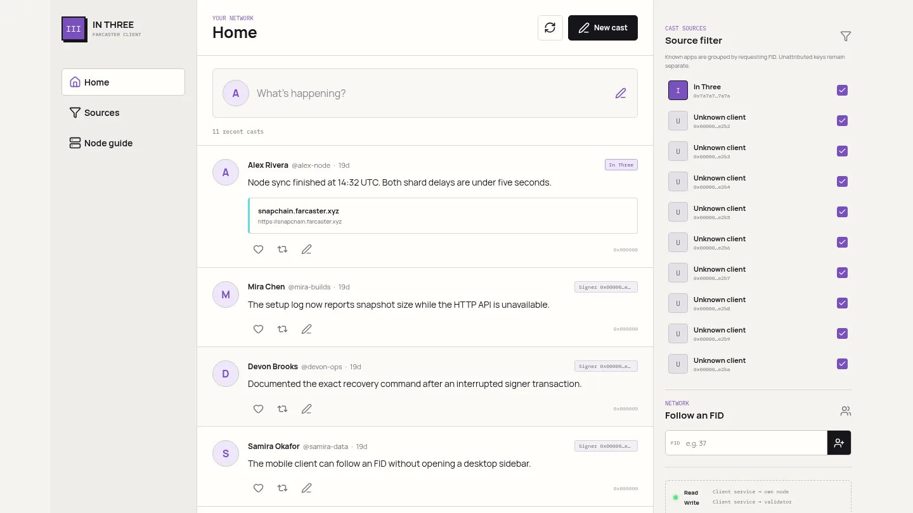

# In Three

**A three-command path from bare compute to a sovereign Farcaster client.**

[Live tutorial](https://farcaster.permanentupperclass.com/) | [Tester bounties](TESTER-BOUNTY.md) | [Agent API](docs/AGENT-API.md) | [Architecture](docs/ARCHITECTURE.md) | [Security](SECURITY.md) | [Voucher runbook](VOUCHER.md)

In Three provisions a persistent host, starts a Snapchain read node, and deploys a small Farcaster client. The client reads from that node and submits signed messages back to it. The read node validates each message and gossips it to validators for inclusion. No hosted Farcaster data API or write API is involved.

The setup flow creates a scoped, gasless Farcaster app key. It does not send an Optimism transaction. The delegated key can publish casts, reactions, and follows; it cannot transfer custody of the account.

> **Developer flow, test accounts only.** A recovery phrase is full account control. Read and trust the source before entering one, use an otherwise disposable test account, and never send a phrase through chat or to a remote host. Production clients should use delegated signer authorization through a trusted wallet instead of asking users for raw phrases.

A running instance can also sell agent access over x402 v2 on Celo and Base. Paid reads are public. Paid writes also require an owner-issued capability. Revenue settles to an immutable 0xSplits contract: 95% to the operator and 5% to P-U-C.



*Illustrative preview. The accounts and casts are synthetic; the deployed client displays data from its own node.*

## Container quickstart

The supported operator image is versioned for amd64 and arm64. The host needs Docker, Bash, curl, gzip, and either `sha256sum` or `shasum`; the application itself runs inside the image.

```bash
mkdir in-three-node
cd in-three-node
curl -fsSLO https://raw.githubusercontent.com/P-U-C/farcaster-in-three/v0.1.2/in-three-container
chmod +x in-three-container
./in-three-container doctor
```

The launcher is short enough to inspect. On first use it downloads the architecture-specific image from the tagged GitHub release, verifies its SHA-256 file, and loads it into Docker. It then runs the image as your UID/GID, mounts only the current directory, uses a read-only root filesystem, drops Linux capabilities, and never mounts the Docker socket. Keys, receipts, deployment state, and the cached release archive stay in `.state/` in the current directory.

Then run the three commands:

```bash
./in-three-container provision
./in-three-container node up
./in-three-container client create
```

`node up` returns once the node is safely bootstrapping. `client create` waits for the local Snapchain API, reports snapshot and disk progress, and continues when the node is ready.

After the launcher has loaded the local image, direct Compose usage is also available:

```bash
curl -fsSLO https://raw.githubusercontent.com/P-U-C/farcaster-in-three/v0.1.2/in-three.compose.yml
IN_THREE_UID="$(id -u)" IN_THREE_GID="$(id -g)" \
  docker compose -f in-three.compose.yml run --rm in-three doctor
```

## Prebuilt host package

The versioned npm tarball contains compiled server and browser assets. It does not build TypeScript or Vite on the operator machine.

```bash
npm install --global https://github.com/P-U-C/farcaster-in-three/releases/download/v0.1.2/farcaster-in-three-0.1.2.tgz
mkdir in-three-node
cd in-three-node
in-three doctor
```

A source checkout remains available for review and development:

```bash
git clone https://github.com/P-U-C/farcaster-in-three.git
cd farcaster-in-three
./farcaster doctor
```

## What the commands do

- `provision` shows the Hetzner plan, asks for `PROVISION`, and creates the server, 2 TiB volume, firewall, and dedicated SSH key.
- `node up` verifies the pinned release and validator manifest, then starts Snapchain snapshot bootstrap.
- `client create` validates the browser password and payment credentials, opens an SSH tunnel to your node, and only then begins the local test-account key ceremony.
- `destroy` names the resources it will delete and requires `DESTROY`.

During `client create`, setup:

1. Requires the exact acknowledgement `TEST ACCOUNT` before it asks for a phrase.
2. Resolves the account's FID and storage through your read node.
3. Creates an Ed25519 signer limited to casts, reactions, and follows.
4. Signs a gasless `KEY_ADD` with a 90-day sliding TTL and the FID's next nonce.
5. Saves the exact protobuf, its hash, checksum, and app key before submission.
6. Submits that message to your read node through the local SSH tunnel.
7. Waits until the signer appears in the node's unified signer API.
8. Uploads only the revocable app key to the server and discards the phrase with process exit.

A read node has no mempool. HTTP success means the message was accepted for relay, not that a validator included it in a block. Treat a later read from the node as confirmation.

## One-payment deployment

A deployed In Three broker can sell the fixed provisioning step for one x402 payment. The buyer still owns the Hetzner project and performs the test-account ceremony locally.

The container route uses a dedicated, low-balance Base buyer key:

```bash
./in-three-container deploy \
  --service https://YOUR_BROKER \
  --payment-network base
```

The command first performs a free cloud-token and plan preflight, displays the exact x402 quote, and requires `BUY DEPLOY`. Its default ceiling is 25 USDC. Hetzner separately bills the server, IPv4 address, traffic, tax, and volume until `destroy` succeeds.

For Celo, install `@celo/buy@0.8.3` on the host and use its operating-system keychain:

```bash
npm install -g @celo/buy@0.8.3
buy setup --name in-three
in-three deploy --service https://YOUR_BROKER --payment-network celo
```

The usebuy.ai file keystore is development-only and refuses mainnet. The container does not weaken that safeguard. Use the host package for the Celo rail, or use the container's in-memory Base payer.

Paid-deployment state is resumable. If a paid response is interrupted, rerun the same command from the same directory. A payment-pending marker blocks a second purchase until the saved entitlement or receipt is resolved.

Use a new, otherwise-empty Hetzner project and rotate its token after provisioning. The broker receives the token over HTTPS for the bounded provisioning request and retains only a SHA-256 binding. It never receives the SSH private key, Farcaster phrase, browser password, or app signer.

## Components

| Layer | Implementation | Boundary |
| --- | --- | --- |
| Compute | Hetzner CCX host and 2 TiB volume | Dedicated project and SSH key |
| Node | Snapchain 0.14.3 pinned by image digest | HTTP/gRPC private; QUIC gossip public |
| Signer | Gasless scoped Farcaster `KEY_ADD` | Phrase local; app key revocable |
| Client | React UI, Node service, official message builders | Reads and writes through owned node |
| Edge | Caddy 2.10.2 with automatic TLS | Password and signed HttpOnly session |
| Agent gateway | x402 v2, Celo and Base USDC | Payment credentials isolated from signer |
| Revenue | Immutable 0xSplits V2 95/5 split | No bridge in the purchase path |

The client displays a chronological feed, posts and deletes casts, follows and unfollows FIDs, and likes, recasts, and removes reactions. Source controls expose every signer key. Keys with the same available app attribution are grouped, while unattributed keys remain individually selectable.

## Requirements

Container operator:

- Docker 24 or newer on Linux or macOS
- Bash and curl for the launcher
- Hetzner Cloud API token with resource creation permission
- Celo x402 facilitator key and Coinbase CDP Secret API key for a deployed agent gateway
- Small CELO and ETH balances only if the deterministic Celo/Base revenue split contracts do not yet exist

Farcaster test account:

- Existing FID and at least one storage unit
- Recovery phrase for that test account
- No Optimism ETH is required for app-key registration

Node:

- Public IPv4 address
- 4 or more vCPU
- 16 GiB or more RAM
- At least 1.5 TB free storage

The initial snapshot is several hundred gigabytes and commonly takes hours to download, extract, and catch up.

## Operations

```bash
./in-three-container node status
./in-three-container node logs
./in-three-container client status
./in-three-container client logs
./in-three-container destroy
```

For package or source installs, replace `./in-three-container` with `in-three` or `./farcaster`.

The owner-only `.state/client.env.pending` file makes setup recoverable. It may contain the app key, exact gasless `KEY_ADD` protobuf, message hash and checksum, payment credentials, agent capability, and exact serialized Celo/Base split transactions. On an ambiguous response, rerun `client create`; it checks node state first and resubmits only the saved message. It removes signed payloads as each action confirms and deletes the pending file after both public health checks pass.

See [docs/OPERATIONS.md](docs/OPERATIONS.md) for expected output, costs, upgrades, recovery, and domain changes.

## Verification

```bash
npm ci
npm run check
npm run build
npm audit --audit-level=moderate
docker build -f Dockerfile.operator -t in-three-operator:test .
docker run --rm in-three-operator:test doctor
node scripts/visual-check.mjs
```

The test suite covers password and session handling, gasless `KEY_ADD` recovery, read-node write submission, x402 pricing and payment bounds, provisioning idempotency, secret separation, feed construction, complete source filtering, mobile Follow access, production builds, dependency audit, and desktop/mobile rendering.

Automated tests do not establish that a multi-terabyte mainnet sync and public post work end to end. Prize qualification still requires the independent [voucher run](VOUCHER.md).

## Repository map

```text
Dockerfile.operator         versioned OCI operator image
in-three-container          isolated Docker launcher
farcaster                   source-checkout entrypoint
scripts/                    provisioning, deployment, recovery, teardown
deploy/                     pinned Snapchain and Caddy deployment
apps/client/src/            node reader, writer, auth, and setup
apps/client/web/            responsive reference client
site/                       public tutorial
skills/in-three/            paid-agent operating skill
docs/                       architecture, operations, API, and sources
```

## Security and licensing

This is reference software, not audited wallet software. Review [SECURITY.md](SECURITY.md) before entering a test-account phrase.

Original code and documentation are MIT licensed. The deployment runs the official GPL-3.0 `farcasterxyz/snapchain` image by immutable digest; it is not copied into or relicensed by this repository. Other dependencies retain their own licenses.
